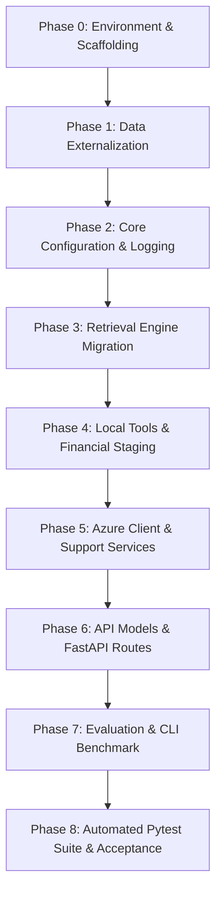

# SupportPilot: Local Application Migration Plan

**Date:** 2026-11-15  
**Architect:** Senior Python Engineer, Applied AI Engineer & Software Architect  
**Project:** SupportPilot — AI-Powered E-Commerce Customer Support Assistant  
**Source:** `notebooks/SupportPilot_AI_Prototype_Repaired.ipynb`  
**Target:** Modular Production-Ready FastAPI & Python Application  
**Status:** **AWAITING USER APPROVAL (Phase 1 Audit Complete)**  

---

## 1. Migration Overview & Core Directives

This migration plan defines the phased, dependency-ordered engineering roadmap to transition SupportPilot from a single Google Colab exploratory notebook into a robust, modular, testable local Python application.

### Governing Rules & Constraints:
1. **Preserve Original Notebook:** `notebooks/SupportPilot_AI_Prototype_Repaired.ipynb` is strictly read-only and will never be overwritten or deleted.
2. **Preserve Existing Capabilities:** All 25 policy documents, 3 synthetic orders, hybrid retrieval logic, relevance gating, and tool capabilities must be preserved with zero silent feature drops.
3. **Preserve Retrieval Algorithms:** Candidate retrieval remains **Hybrid RRF 1:1** ($k=60$) fusing FAISS cosine similarity and BM25Okapi scores. Algorithmic changes will not be introduced without reproducible benchmark evidence.
4. **Strict Financial Safety:** Refunds are **only staged** for human supervisor approval. Automated payment execution, disburse rails, or direct bank integrations are prohibited.
5. **No Secret Leakage:** All credentials and endpoints are loaded from `.env` via `pydantic-settings`. No keys or private endpoints are committed to source control.
6. **No Fake AI Answers:** Eliminates misleading canned mock answers that misattribute document IDs.
7. **Offline Determinism:** All unit and integration test suites run 100% offline without requiring an active Azure AI Foundry subscription or key.
8. **Explicit Sign-Off Gate:** **No application code migrations will execute until the user reviews and approves this plan.**

---

## 2. Phased Migration Roadmap



---

### Phase 0: Environment Foundation & Scaffolding
- **Objective:** Establish the clean directory structure and verify local dependencies.
- **Tasks:**
  1. Confirm Python 3.11.18 virtual environment (`.venv`) and `uv` package manager readiness.
  2. Verify `.gitignore` contains `.env`, `*.env`, `__pycache__`, and `.pytest_cache`.
  3. Create standard package directories:
     `app/core`, `app/retrieval`, `app/services`, `app/tools`, `app/api`, `app/models`, `data/policies`, `data/orders`, `evaluation/datasets`, `tests/unit`, `tests/integration`, `scripts`.
  4. Ensure `.env.example` contains sanitized placeholders.
- **Deliverables:** Directory structure with empty `__init__.py` markers.
- **Verification Gate:** `python -c "import uv; print('uv OK')"` and directory tree check.

---

### Phase 1: Data Assets Externalization
- **Objective:** Decouple domain knowledge and business data from code.
- **Tasks:**
  1. Extract canonical 25 policy documents (DOC-001 to DOC-025) from Cell 7 into `data/policies/policies.json`.
  2. Extract synthetic orders (`1024`, `1025`, `1026`) from Cell 25 into `data/orders/orders.json`.
  3. Initialize persistent staged refund repository file `data/orders/refund_requests.json` (`[]`).
  4. Extract evaluation datasets (Canonical V1, V2, V3 Development, and Holdout) into `evaluation/datasets/`.
- **Deliverables:** Validated JSON data files in `data/` and `evaluation/datasets/`.
- **Verification Gate:** Schema validation test ensuring 25 unique policies and 3 synthetic orders load cleanly.

---

### Phase 2: Core Configuration & Structured Logging
- **Objective:** Implement type-safe configuration and centralized logging.
- **Tasks:**
  1. Create `app/core/config.py` using `pydantic-settings`:
     - `AZURE_AI_ENDPOINT: str`
     - `AZURE_AI_KEY: Optional[str] = None`
     - `AZURE_MODEL_NAME: str = "gpt-5-mini"`
     - `RETRIEVAL_TOP_K: int = 3`
     - `SIMILARITY_THRESHOLD: float = 0.40`
     - `RRF_K: int = 60`
     - `MAX_OUTPUT_TOKENS: int = 180`
     - `MOCK_MODE: bool = False`
  2. Create `app/core/logging.py` providing structured formatting with request IDs and token metrics.
- **Deliverables:** `app/core/config.py`, `app/core/logging.py`.
- **Verification Gate:** Unit tests validating environment overrides and default values.

---

### Phase 3: Information Retrieval Subsystem
- **Objective:** Modularize embeddings, FAISS indexing, BM25, and Hybrid RRF.
- **Tasks:**
  1. **`app/retrieval/embeddings.py`:**
     - Encapsulate `SentenceTransformer('all-MiniLM-L6-v2')`.
     - Implement `EmbeddingEngine.encode(texts)` enforcing `normalize_embeddings=True`.
  2. **`app/retrieval/vector_store.py`:**
     - Encapsulate `faiss.IndexFlatIP(384)`.
     - Implement `VectorStore.load_and_index(policies_path)`.
     - Implement `VectorStore.search(query, top_k)` returning cosine similarity scores in range $[-1.0, 1.0]$.
  3. **`app/retrieval/bm25.py`:**
     - Implement `BM25Store` with `tokenize_text(text)` regex tokenizer.
     - Build `BM25Okapi` index over title + content corpus.
     - Implement `BM25Store.search(query, top_k)`.
     - Support optional query synonym expansion map from Cell 57 without altering default baseline.
  4. **`app/retrieval/hybrid_search.py`:**
     - Implement `HybridRetriever.search(query, top_k=3)`.
     - Retrieve $2 \times \text{top\_k}$ candidates from vector and BM25 stores.
     - Compute Reciprocal Rank Fusion ($k=60$) scores.
     - Preserve comprehensive metadata: `doc_id`, `title`, `content`, `rrf_score`, `vector_score`, `bm25_score`.
- **Deliverables:** `app/retrieval/*.py`.
- **Verification Gate:** Pytest unit tests verifying Recall@3 = 1.000 on canonical 10 queries.

---

### Phase 4: Local Tools Subsystem & Financial Staging Safety
- **Objective:** Provide robust, thread-safe order tracking and refund staging.
- **Tasks:**
  1. **`app/tools/order_tools.py`:**
     - Implement `OrderService.get_order_status(order_id)`.
     - Clean input (`#` stripping, whitespace trimming).
     - Return structured `OrderLookupResult`.
  2. **`app/tools/refund_tools.py`:**
     - Implement `RefundService.create_refund_request(order_id, reason)`.
     - Verify order existence.
     - Atomic check for existing pending refund for the same `order_id`.
     - Generate sequential `REF-XXXX` identifier.
     - Enforce `status = "pending_human_approval"`.
     - Persist staged record to `data/orders/refund_requests.json` using atomic file writes with file locking (`filelock`).
- **Deliverables:** `app/tools/order_tools.py`, `app/tools/refund_tools.py`.
- **Verification Gate:** Unit tests confirming refund requests are strictly staged for human approval and duplicate requests are flagged.

---

### Phase 5: Azure AI Client & Support Service Orchestration
- **Objective:** Connect LLM generation, relevance gating, and tool dispatch.
- **Tasks:**
  1. **`app/services/azure_ai.py`:**
     - Implement `AzureAIClient.generate_response(prompt, max_output_tokens=180)`.
     - Target Azure OpenAI Responses API (`/openai/v1/responses`).
     - Transmit standard `api-key` header (remediating dual-header issue).
     - Implement exponential backoff for 429/5xx errors; fast-fail on 401/403.
     - Parse response via `extract_text_from_responses_api()`.
     - Track token metrics in a thread-safe container.
  2. **`app/services/support_service.py`:**
     - Implement `check_retrieval_relevance(query)`:
       * Evaluate `top_vector_score` against `SIMILARITY_THRESHOLD` ($0.40$).
       * If below threshold, return `decision: ESCALATE`.
       * If above threshold, return `decision: REVIEW_EVIDENCE` with hybrid evidence documents.
     - Implement `build_grounded_prompt(query, evidence)`:
       * Enclose customer query in `<customer_inquiry>` tags for prompt injection defense.
       * Enforce strict document citation rules (`[DOC-XXX]`).
     - Implement `generate_support_answer(query, mock_mode=False)`:
       * Execute relevance gate.
       * If escalated, return human support escalation message.
       * In live mode, call `AzureAIClient`.
       * In offline mock mode, synthesize safe excerpt stub quoting retrieved documents (remediating misleading canned answers).
     - Implement `SupportAgent.handle_query(query)`:
       * Regex intent extraction for orders and refunds.
       * Fix bug: route customer refund inquiries through knowledge base search rather than hardcoded query.
       * Fix bug: remove hardcoded `mock_mode=True` to allow live inference.
- **Deliverables:** `app/services/azure_ai.py`, `app/services/support_service.py`.
- **Verification Gate:** Integration tests verifying agent flow with mock Azure client.

---

### Phase 6: API Layer & Pydantic Schemas
- **Objective:** Expose the support assistant via a modern FastAPI web interface.
- **Tasks:**
  1. **`app/models/requests.py` & `responses.py`:**
     - Define `ChatRequest`, `ChatResponse`, `OrderResponse`, `RefundCreateRequest`, `RefundResponse`, `HealthResponse`.
  2. **`app/api/routes.py`:**
     - `POST /api/chat`: Customer chat endpoint.
     - `GET /api/orders/{order_id}`: Order lookup.
     - `POST /api/refunds`: Explicit refund staging.
     - `GET /api/health`: System health (documents indexed, model loaded, status).
  3. **`app/main.py`:**
     - FastAPI application instance.
     - Lifespan context manager: pre-loads embedding model and builds FAISS/BM25 indices at startup.
     - CORS middleware and exception handlers.
- **Deliverables:** `app/models/*.py`, `app/api/routes.py`, `app/main.py`.
- **Verification Gate:** `httpx` TestClient integration tests verifying all HTTP status codes.

---

### Phase 7: Evaluation Engine & CLI Tooling
- **Objective:** Provide a standalone CLI benchmark tool to reproduce historical retrieval and generation metrics.
- **Tasks:**
  1. **`app/services/evaluation.py`:**
     - Implement `recall_at_k()`, `mean_reciprocal_rank()`, `hit_rate_at_k()`.
     - Implement `evaluate_answer_quality()` with multi-phrase concept verification.
  2. **`evaluation/benchmark.py`:**
     - CLI script supporting:
       `python -m evaluation.benchmark --dataset canonical --k 3`
       `python -m evaluation.benchmark --dataset v3 --k 5`
       `python -m evaluation.benchmark --live` (opt-in Azure evaluation).
  3. **`scripts/build_indices.py`:**
     - Utility to pre-build and cache FAISS index to disk.
- **Deliverables:** `evaluation/benchmark.py`, `scripts/build_indices.py`.
- **Verification Gate:** Benchmark script runs locally and outputs Markdown/CSV comparison tables.

---

### Phase 8: Verification & Acceptance Sign-Off
- **Objective:** Comprehensive testing and validation of the migrated system.
- **Tasks:**
  1. Run full offline test suite: `uv run pytest tests/`.
  2. Confirm 100% test pass rate with zero Azure API key requirement.
  3. Verify `README.md` includes setup, running, testing, and deployment instructions.
  4. Present completed application and audit verification to user.

---

## 3. Dependency Graph & Critical Path

```text
Phase 0 (Environment)
   │
   ▼
Phase 1 (Data Externalization: policies.json, orders.json)
   │
   ▼
Phase 2 (Core Config & Logging)
   │
   ├──────────────────────────────┐
   ▼                              ▼
Phase 3 (Retrieval Engine)     Phase 4 (Order & Refund Tools)
   │                              │
   └──────────────┬───────────────┘
                  ▼
Phase 5 (Azure Client & Support Service Orchestration)
                  │
                  ▼
Phase 6 (FastAPI API & Pydantic Schemas)
                  │
                  ▼
Phase 7 (Evaluation CLI & Scripts)
                  │
                  ▼
Phase 8 (Verification & Acceptance Testing)
```

---

## 4. Rollback & Safety Gates

1. **Safety Gate 1:** The original notebook `SupportPilot_AI_Prototype_Repaired.ipynb` remains unmodified. If migration fails or requires reconsideration, the original prototype remains 100% intact.
2. **Safety Gate 2:** No payment processing code or automated disbursement hooks will be written under any circumstance.
3. **Safety Gate 3:** Every phase requires passing automated unit tests before proceeding to downstream modules.
4. **Safety Gate 4:** Execution of Phase 1 through Phase 8 will **commence only after explicit user sign-off**.
